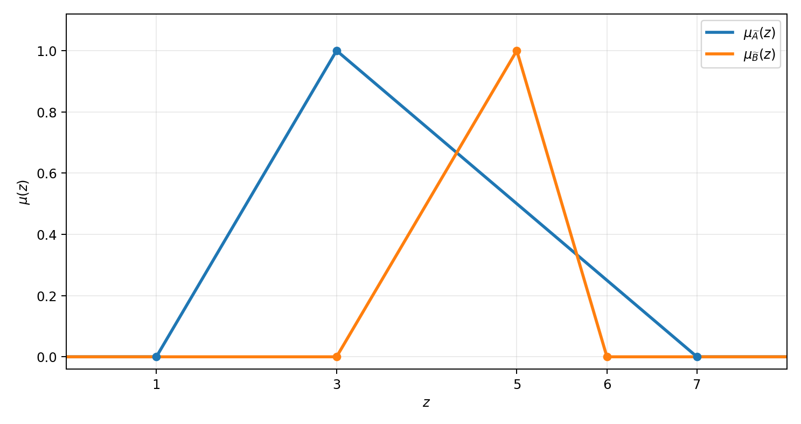
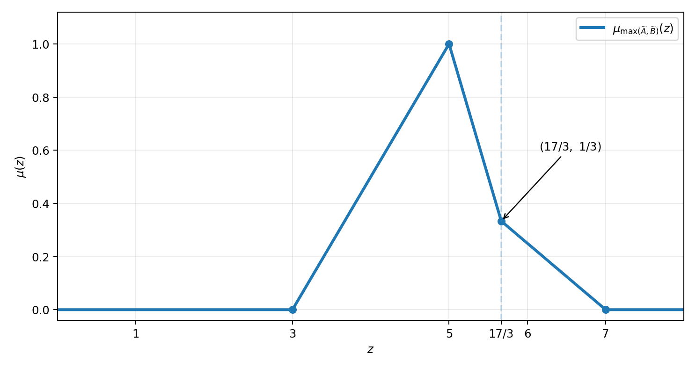

# تمرین سوم — اعداد فازی مثلثی و ماکزیمم آن‌ها

> **موعد تحویل در برگهٔ تمرین:** یکشنبه ۳ آبان ۱۴۰۵.

> **منبع:** برگهٔ یک‌صفحه‌ای تمرین سوم درس. داده‌ها و خواسته‌های تمرین از برگهٔ ارسالی بازنویسی شده‌اند؛ محاسبات، تعیین نقطهٔ تغییر ضابطه، اثبات و نمودارها حل مستقلی هستند. تصویر اصل تمرین در سایت بازنشر نمی‌شود.

طبق صورت سؤال، دو عدد فازی مثلثی داریم:

$$\widetilde A=(1,3,7),\qquad \widetilde B=(3,5,6).$$

در سؤال اول، باید تابع عضویت هر عدد را **به‌صورت چندضابطه‌ای** بنویسیم و هر دو نمودار را روی یک دستگاه مختصات رسم کنیم. در سؤال دوم، باید با **اصل گسترش زاده** تابع عضویت ماکزیمم دو عدد را به دست آوریم و با توضیح شرط $\max(x,y)=z$، محاسبهٔ سوپریمم، تعیین بازه‌ها و نقاط تغییر ضابطه، نمودار نهایی را رسم کنیم.

## ۱. تابع عضویت هر عدد فازی

اگر $T=(a,b,c)$ یک عدد فازی مثلثی با $a<b<c$ باشد:

$$\mu_T(z)=\begin{cases}
0 & z\le a,\\
\dfrac{z-a}{b-a} & a<z\le b,\\
\dfrac{c-z}{c-b} & b<z<c,\\
0 & z\ge c.
\end{cases}$$

با جای‌گذاری اعداد داده‌شده، **پاسخ سؤال اول** چنین است:

$$\boxed{\mu_{\widetilde A}(z)=\begin{cases}
0 & z\le1,\\
\dfrac{z-1}{2} & 1<z\le3,\\
\dfrac{7-z}{4} & 3<z<7,\\
0 & z\ge7,
\end{cases}}$$

$$\boxed{\mu_{\widetilde B}(z)=\begin{cases}
0 & z\le3,\\
\dfrac{z-3}{2} & 3<z\le5,\\
6-z & 5<z<6,\\
0 & z\ge6.
\end{cases}}$$

نقاط اصلی نمودار $A$ عبارت‌اند از $(1,0)$، $(3,1)$، $(7,0)$ و نقاط نمودار $B$ عبارت‌اند از $(3,0)$، $(5,1)$، $(6,0)$. هر دو نمودار بین این نقاط خطی‌اند.



## ۲. تفسیر دقیق شرط اصل گسترش

طبق سؤال دوم، تابع $\max$ را با **اصل گسترش زاده** و عملگر کمینه داریم:

$$\boxed{\mu_Z(z)=\sup_{\substack{x,y\in\mathbb R\\\max(x,y)=z}}
\min\bigl(\mu_{\widetilde A}(x),\mu_{\widetilde B}(y)\bigr).}$$

شرط $\max(x,y)=z$ یعنی **هر دو متغیر حداکثر $z$ باشند و حداقل یکی دقیقاً $z$ باشد**. بنابراین:

$$\{(x,y):\max(x,y)=z\}=
\{(z,y):y\le z\}\cup\{(x,z):x\le z\}.$$

**اشتباه رایج:** تابع عضویت ماکزیمم دو عدد فازی، لزوماً ماکزیمم نقطه‌ای دو تابع عضویت آن‌ها نیست؛ مثلاً در $z=3$ ماکزیمم نقطه‌ای درجه‌های عضویت برابر ۱، ولی تابع عضویت $Z$ برابر صفر است.

## ۳. محاسبهٔ سوپریمم با استدلال

بیشترین درجه عضویت قابل‌دستیابی **در نقاط حداکثر $z$** را تعریف می‌کنیم:

$$M_A(z)=\sup_{x\le z}\mu_{\widetilde A}(x),\qquad
M_B(z)=\sup_{y\le z}\mu_{\widetilde B}(y).$$

از شکل دو عدد مثلثی داریم:

$$M_A(z)=\begin{cases}0&z<1,\\(z-1)/2&1\le z<3,\\1&z\ge3,\end{cases}
\quad M_B(z)=\begin{cases}0&z<3,\\(z-3)/2&3\le z<5,\\1&z\ge5.\end{cases}$$

چون شرط $\max(x,y)=z$ اجتماع دو حالت بالاست، سوپریمم برابر بزرگ‌ترین سوپریمم آن دو حالت است:

$$\boxed{\mu_Z(z)=\max\left\{
\min\bigl(\mu_A(z),M_B(z)\bigr),
\min\bigl(\mu_B(z),M_A(z)\bigr)
\right\}.}$$

این رابطه مسئلهٔ جست‌وجوی دو متغیره را به دو محاسبهٔ دقیق یک‌متغیره تبدیل می‌کند. وقتی مقدار مثبت است، بیشینه واقعاً قابل‌دستیابی است، زیرا توابع عضویت پیوسته و تکیه‌گاه آن‌ها کراندار است.

## ۴. بررسی بازه‌ها و محل تغییر ضابطه

**بازهٔ $z<3$:** برای درجهٔ عضویت مثبتِ عدد $B$ باید $y>3$ باشد، اما در این صورت $\max(x,y)=z<3$ نمی‌شود؛ بنابراین $\mu_Z(z)=0$.

**بازهٔ $3\le z\le5$:** چون برای $z\ge3$ می‌توان $x=3$ و $\mu_A(x)=1$ انتخاب کرد، حالت $y=z$ درجهٔ عضویت $(z-3)/2$ می‌دهد. حالت دیگر از این مقدار بیشتر نمی‌شود زیرا $M_B(z)=\mu_B(z)$؛ پس:

$$\boxed{\mu_Z(z)=\frac{z-3}{2}\qquad(3\le z\le5).}$$

**بازهٔ $5<z<6$:** در این بازه هر دو $M_A(z)$ و $M_B(z)$ برابر ۱ هستند، و باید بین دو مقدار زیر بزرگ‌ترین را انتخاب کنیم:

$$\frac{7-z}{4},\qquad6-z.$$

محل برابری دو عبارت:

$$\frac{7-z}{4}=6-z
\quad\Longrightarrow\quad 7-z=24-4z
\quad\Longrightarrow\quad\boxed{z=\frac{17}{3}}.$$

برای $5<z<17/3$ عبارت $6-z$ بزرگ‌تر است و برای $17/3<z<6$ عبارت $(7-z)/4$ بزرگ‌تر است.

**بازهٔ $6\le z\le7$:** تابع عضویت $B$ صفر و تابع عضویت $A$ برابر $(7-z)/4$ است؛ پس همین ضابطه باقی می‌ماند. برای $z>7$ هر دو صفرند.

## ۵. جواب نهایی و نمودار

بنابراین **پاسخ سؤال دوم** چنین است:

$$\boxed{\mu_{\max(\widetilde A,\widetilde B)}(z)=
\begin{cases}
0 & z<3,\\
\dfrac{z-3}{2} & 3\le z\le5,\\
6-z & 5<z\le\dfrac{17}{3},\\
\dfrac{7-z}{4} & \dfrac{17}{3}<z\le7,\\
0 & z>7.
\end{cases}}$$

نقاط مهم نمودار عبارت‌اند از $(3,0)$، $(5,1)$، $(17/3,1/3)$ و $(7,0)$. عدد فازی حاصل **نرمال** است (در $z=5$ درجه عضویت یک دارد)، اما مثلثی نیست؛ چون شیب شاخهٔ نزولی در $17/3$ عوض می‌شود.



## ۶. بررسی مستقل با برش‌های آلفا

برای $0\le\alpha\le1$، برش‌های آلفای دو عدد فازی برابرند با:

$$\widetilde A_\alpha=[1+2\alpha,7-4\alpha],\qquad
\widetilde B_\alpha=[3+2\alpha,6-\alpha].$$

به‌علت صعودی بودن عملگر ماکزیمم و طبق اصل گسترش:

$$Z_\alpha=[\max(1+2\alpha,3+2\alpha),\max(7-4\alpha,6-\alpha)]
=[3+2\alpha,\max(7-4\alpha,6-\alpha)].$$

کران راست وقتی تغییر ضابطه می‌دهد که:

$$7-4\alpha=6-\alpha\quad\Longrightarrow\quad\alpha=\frac13.$$

این مقدار با $z=7-4/3=17/3$ متناظر است؛ پس نتیجهٔ سؤال دوم از دو روش مستقل یکسان به دست می‌آید.

## ۷. بررسی اختیاری با Python

[کد اجرایی و قابل‌بازتولید پایتون](https://github.com/SoheilGtex/mathematical-modeling-lab/blob/main/examples/assignments/03_fuzzy_numbers_max.py) برای کنترل ضابطه‌ها و رسم نمودارها در ریپو قرار می‌گیرد. اجرای آن از ریشهٔ پروژه:

```bash
python examples/assignments/03_fuzzy_numbers_max.py
python -m pytest -q tests/test_assignment_03.py
```

این کد مقادیر تابع عضویت حاصل را به دو روش، در نقاط مختلف، مقایسه می‌کند و برش‌های آلفا را نمایش می‌دهد. **راه‌حل تحلیلی بالا مستقل از اجرای نرم‌افزار کامل است.**
