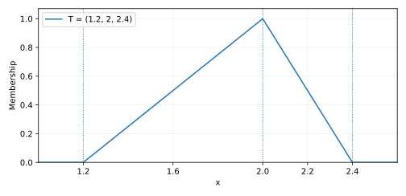

# Fuzzy-set foundations and membership functions

**Lecture source: page 1.** This page defines a fuzzy subset of the real line, strong alpha-cuts, support and core, and triangular and trapezoidal membership functions.

## 1. Fuzzy sets and the meaning of membership

A fuzzy set on $\mathbb R$ is specified by a membership function

$$\mu_{\widetilde A}:\mathbb R\longrightarrow[0,1],\qquad
\widetilde A=\{(x,\mu_{\widetilde A}(x)):x\in\mathbb R\}. $$

$\mu_{\widetilde A}(x)=1$ means full membership and $\mu_{\widetilde A}(x)=0$ means no membership. Intermediate values represent graded membership, **not necessarily probability**. A conventional crisp indicator takes values only in $\{0,1\}$.

## 2. Alpha-cuts, support, and core

The handwritten note uses the *strict* inequality

$$\widetilde A_{\alpha}^{>}=\{x:\mu_{\widetilde A}(x)>\alpha\}.$$

This is called a **strong alpha-cut**. The standard **weak (closed) alpha-cut** is

$$[\widetilde A]_{\alpha}=\{x:\mu_{\widetilde A}(x)\ge\alpha\},\quad 0<\alpha\le1.$$

For $\alpha=0$, one normally defines the zero-cut of a fuzzy number as the **closure of its positive support**, rather than $\{x:\mu(x)\ge0\}=\mathbb R$. These conventions are distinct: the strong cut at $\alpha=1$ is empty, even for a normalized fuzzy number.

The source also defines

$$\operatorname{supp}(\widetilde A)=\{x:\mu_{\widetilde A}(x)>0\},\qquad
\operatorname{core}(\widetilde A)=\{x:\mu_{\widetilde A}(x)=1\}.$$

Some authors call the *closure* of the first set “support”; this page follows the handwritten $\mu>0$ convention. The core is a point for an ordinary triangle and an interval for a trapezoid.

## 3. Triangular fuzzy numbers

For $a<b<c$, the triangle $\widetilde T=(a,b,c)$ has

$$\mu_{\widetilde T}(x)=\begin{cases}
0,&x\le a,\\
\dfrac{x-a}{b-a},&a<x\le b,\\
\dfrac{c-x}{c-b},&b<x<c,\\
0,&x\ge c.
\end{cases}$$

The lecture's numerical example is $\widetilde T=(1.2,2,2.4)$, with apex $(2,1)$, left spread $0.8$ and right spread $0.4$. The **same fuzzy number** can be written in LR form as $(m,\ell,r)=(2,0.8,0.4)$, where $m$ is the mode—not the left endpoint.

For $0\le\lambda\le1$, the closed level-set interval (with the zero-cut convention above) is

$$[\widetilde T]_{\lambda}=[a+(b-a)\lambda,\ c-(c-b)\lambda].$$

For the lecture triangle, $[\widetilde T]_{1/2}=[1.6,2.2]$.

## 4. Trapezoidal fuzzy numbers

For $a<b\le c<d$, a trapezoid $\widetilde Q=(a,b,c,d)$ satisfies

$$\mu_{\widetilde Q}(x)=\begin{cases}
0,&x\le a,\\
\dfrac{x-a}{b-a},&a<x<b,\\
1,&b\le x\le c,\\
\dfrac{d-x}{d-c},&c<x<d,\\
0,&x\ge d.
\end{cases}$$

Its core is $[b,c]$, its positive support is $(a,d)$, and its level interval is

$$[\widetilde Q]_{\lambda}=[a+(b-a)\lambda,\ d-(d-c)\lambda].$$

The source parameterizes the same trapezoid using a *core interval* and *left/right spreads*:

$$\widetilde Q=(a^L,a^U,\alpha,\beta)_{LR}
\quad\Longleftrightarrow\quad(a,b,c,d)=(a^L-\alpha,a^L,a^U,a^U+\beta).$$

**Handwritten inconsistency (page 1):** the right-shoulder domain appears to end at $a^L+\beta$, but the sketch and the right core endpoint require $a^U+\beta$. We use the mathematically consistent bound above and explicitly record this correction here.

The triangle is the special case $a^L=a^U$. **Important:** the letter $\alpha$ in this LR four-tuple denotes a *spread*, not the alpha-cut level; we use $\lambda$ for level throughout these pages.
