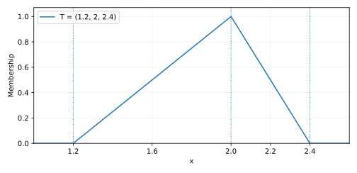

# مبانی مجموعه‌های فازی و تابع عضویت

**منبع: صفحهٔ ۱ جزوه.** در این صفحه مجموعهٔ فازی، برش آلفا، تکیه‌گاه، هسته و توابع عضویت مثلثی و ذوزنقه‌ای معرفی شده‌اند.

## ۱. مجموعهٔ فازی و درجهٔ عضویت

مجموعهٔ فازی روی خط حقیقی با تابعی به شکل زیر مشخص می‌شود:

$$\mu_{\widetilde A}:\mathbb R\longrightarrow[0,1],\qquad
\widetilde A=\{(x,\mu_{\widetilde A}(x)):x\in\mathbb R\}.$$

مقدار $\mu_{\widetilde A}(x)=1$ یعنی عضویت کامل و مقدار صفر یعنی نداشتن عضویت. مقدارهای بین صفر و یک، **درجهٔ عضویت** هستند؛ نباید بدون فرض اضافی آن‌ها را احتمال تفسیر کرد. در مجموعه‌های معمولی، تابع مشخصه فقط صفر یا یک است.

## ۲. برش آلفا، تکیه‌گاه و هسته

در جزوه برای برش آلفا از نامساوی سخت استفاده شده است:

$$\widetilde A_{\alpha}^{>}=\{x:\mu_{\widetilde A}(x)>\alpha\}.$$

به این مجموعه **برش آلفای قوی** می‌گویند. تعریف رایج دیگر، **برش آلفای معمولی** است:

$$[\widetilde A]_{\alpha}=\{x:\mu_{\widetilde A}(x)\ge\alpha\},\qquad 0<\alpha\le1.$$

برای سطح صفر، منظور از برش صفر معمولاً بستار مجموعهٔ نقاطی است که درجهٔ عضویت مثبت دارند؛ زیرا شرط $\mu(x)\ge0$ به‌تنهایی همهٔ خط حقیقی را در بر می‌گیرد. این تمایز مهم است: برش قوی در سطح یک همیشه تهی است، حتی اگر مجموعه عضویت کامل داشته باشد.

طبق جزوه:

$$\operatorname{supp}(\widetilde A)=\{x:\mu_{\widetilde A}(x)>0\},\qquad
\operatorname{core}(\widetilde A)=\{x:\mu_{\widetilde A}(x)=1\}.$$

این‌جا «تکیه‌گاه» به معنای نقاط با عضویت مثبت است. بعضی کتاب‌ها بستار این مجموعه را تکیه‌گاه می‌نامند. هستهٔ عدد مثلثی معمولاً یک نقطه و هستهٔ عدد ذوزنقه‌ای یک بازه است.

## ۳. عدد فازی مثلثی

برای $a<b<c$ عدد $\widetilde T=(a,b,c)$ به‌صورت زیر تعریف می‌شود:

$$\mu_{\widetilde T}(x)=\begin{cases}
0,&x\le a,\\
\dfrac{x-a}{b-a},&a<x\le b,\\
\dfrac{c-x}{c-b},&b<x<c,\\
0,&x\ge c.
\end{cases}$$

مثال عددی صفحهٔ اول $\widetilde T=(1.2,2,2.4)$ است. رأس نمودار در $(2,1)$، گستردگی سمت چپ برابر $0.8$ و سمت راست برابر $0.4$ است. همین عدد را می‌توان با نمایش مثلثی $LR$ به شکل $(m,\ell,r)=(2,0.8,0.4)$ نوشت. **عدد اول در نمایش LR مرکز عدد فازی است، نه کران چپ.**

بازهٔ برش معمولی در سطح $0\le\lambda\le1$ چنین است:

$$[\widetilde T]_{\lambda}=[a+(b-a)\lambda,\ c-(c-b)\lambda].$$

مثلاً برای عدد جزوه، $[\widetilde T]_{1/2}=[1.6,2.2]$.

## ۴. عدد فازی ذوزنقه‌ای

برای $a<b\le c<d$ تابع عضویت $\widetilde Q=(a,b,c,d)$ برابر است با:

$$\mu_{\widetilde Q}(x)=\begin{cases}
0,&x\le a,\\
\dfrac{x-a}{b-a},&a<x<b,\\
1,&b\le x\le c,\\
\dfrac{d-x}{d-c},&c<x<d,\\
0,&x\ge d.
\end{cases}$$

هستهٔ این عدد بازهٔ $[b,c]$ و تکیه‌گاه مثبت آن $(a,d)$ است. برش سطح $\lambda$ نیز از رابطهٔ زیر به دست می‌آید:

$$[\widetilde Q]_{\lambda}=[a+(b-a)\lambda,\ d-(d-c)\lambda].$$

جزوه برای همین ذوزنقه نمایش مبتنی بر هسته و گستردگی دو طرف را به کار می‌برد:

$$\widetilde Q=(a^L,a^U,\alpha,\beta)_{LR}
\quad\Longleftrightarrow\quad(a,b,c,d)=(a^L-\alpha,a^L,a^U,a^U+\beta).$$

**یادداشت تصحیح از صفحهٔ اول:** در بازهٔ شاخهٔ راستِ تعریف دست‌نویس، کران بالا ظاهراً به‌صورت $a^L+\beta$ نوشته شده، اما مطابق نمودار و نقطهٔ شروع شاخهٔ راست، باید $a^U+\beta$ باشد. در فرمول استاندارد بالا این ناسازگاری با توضیح اصلاح شده است؛ بدون اشاره به آن، متن جزوه را تغییر نداده‌ایم.

اگر $a^L=a^U$ باشد، ذوزنقه به عدد مثلثی تبدیل می‌شود. **دقت کنید:** $\alpha$ در چهار‌تایی $LR$ میزان گستردگی سمت چپ است، نه سطح برش؛ در فرمول‌های برش از $\lambda$ استفاده می‌کنیم.
