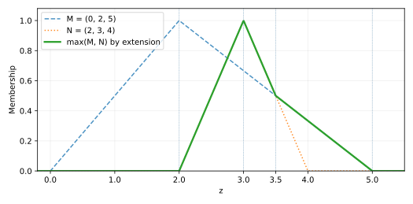

# Extension principle: the maximum of two fuzzy numbers

**Lecture source: pages 4–5.** The lecture computes the membership function of the **fuzzy maximum** of two triangular fuzzy numbers. This is not the pointwise maximum of two membership functions.

## 1. Zadeh's extension principle for max

For fuzzy numbers $\widetilde M$ and $\widetilde N$, define $\widetilde D=\widetilde{\max}(\widetilde M,\widetilde N)$ by

$$\boxed{\mu_{\widetilde D}(z)=
\sup_{\substack{x,y\in\mathbb R\\\max(x,y)=z}}
\min\{\mu_{\widetilde M}(x),\mu_{\widetilde N}(y)\}.}$$

The constraint $\max(x,y)=z$ means **both** $x\le z$ and $y\le z$, with **at least one** of $x,y$ equal to $z$. It does not mean $\max\{\mu_M(z),\mu_N(z)\}$.

## 2. The two lecture triangles

The source uses

$$\widetilde M=(0,2,5),\qquad \widetilde N=(2,3,4).$$

Their membership functions are

$$\mu_M(x)=\begin{cases}
x/2,&0\le x\le2,\\
(5-x)/3,&2<x\le5,\\
0,&\text{otherwise},
\end{cases}\qquad
\mu_N(y)=\begin{cases}
y-2,&2\le y\le3,\\
4-y,&3<y\le4,\\
0,&\text{otherwise}.
\end{cases}$$

## 3. Fast rigorous method: alpha-cuts

For every $0\le\lambda\le1$, the level intervals are

$$[M]_\lambda=[2\lambda,5-3\lambda],\qquad
[N]_\lambda=[2+\lambda,4-\lambda].$$

The continuous, coordinatewise nondecreasing map $(x,y)\mapsto\max(x,y)$ sends the rectangle of the two cuts to the interval

$$[D]_\lambda=
[\max(2\lambda,2+\lambda),\ \max(5-3\lambda,4-\lambda)].$$

Since $2+\lambda\ge2\lambda$, the left endpoint is $2+\lambda$. On the right, the two lines meet when $5-3\lambda=4-\lambda$, i.e. $\lambda=1/2$. Therefore

$$\boxed{[D]_\lambda=\begin{cases}
[2+\lambda,5-3\lambda],&0\le\lambda\le1/2,\\
[2+\lambda,4-\lambda],&1/2\le\lambda\le1.
\end{cases}}$$

This immediately proves the output is normalized, has core $\{3\}$, and has support closure $[2,5]$.

## 4. Final membership function

Invert the cut endpoints. The two descending lines intersect at $z=3.5$ because $(5-z)/3=4-z$.

$$\boxed{\mu_D(z)=\begin{cases}
0,&z\le2,\\
z-2,&2<z\le3,\\
4-z,&3<z\le3.5,\\
(5-z)/3,&3.5<z<5,\\
0,&z\ge5.
\end{cases}}$$

Useful checks: $\mu_D(2.5)=0.5$, $\mu_D(3)=1$, $\mu_D(3.5)=0.5$, and $\mu_D(4)=1/3$. The points $(2,0),(3,1),(3.5,0.5),(5,0)$ determine the graph.

**Common mistake:** at $z=2.5$, $\max\{\mu_M(2.5),\mu_N(2.5)\}=\max\{5/6,1/2\}=5/6$, but the **extension-principle maximum has membership $1/2$**. A pointwise maximum of the two membership curves solves a different problem.

## 5. General shortcut appearing in the notes

For **normal triangular** $M=(a,b,c)$ and $N=(a',b',c')$ with ordered modes $b\le b'$, the same extension principle gives

$$\mu_{\max(M,N)}(z)=\begin{cases}
\min\{\mu_M(z),\mu_N(z)\},&z<b,\\
\mu_N(z),&b\le z\le b',\\
\max\{\mu_M(z),\mu_N(z)\},&z>b'.
\end{cases}$$

This piecewise shortcut uses the **ordered modes and triangular shape**; it must not be applied without verifying those conditions. The alpha-cut formula is a more reliable starting point for new examples.
