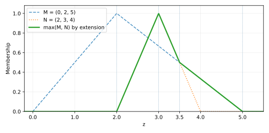

# اصل گسترش و محاسبهٔ بیشینهٔ دو عدد فازی

**منبع: صفحات ۴ و ۵ جزوه.** در این دو صفحه، تابع عضویتِ **بیشینهٔ فازی** دو عدد مثلثی محاسبه شده است. دقت کنید که بیشینهٔ دو عدد فازی با بیشینه‌گرفتن نقطه‌به‌نقطه از دو تابع عضویت یکسان نیست.

## ۱. اصل گسترش برای تابع بیشینه

اگر $\widetilde M$ و $\widetilde N$ دو عدد فازی باشند، عدد فازی $\widetilde D=\widetilde{\max}(\widetilde M,\widetilde N)$ با رابطهٔ زیر تعریف می‌شود:

$$\boxed{\mu_{\widetilde D}(z)=
\sup_{\substack{x,y\in\mathbb R\\\max(x,y)=z}}
\min\{\mu_{\widetilde M}(x),\mu_{\widetilde N}(y)\}.}$$

شرط $\max(x,y)=z$ یعنی $x\le z$ و $y\le z$ و دست‌کم یکی از این دو مقدار باید با $z$ برابر باشد. بنابراین نمی‌توان مستقیم $\max\{\mu_M(z),\mu_N(z)\}$ را به‌عنوان جواب نوشت.

## ۲. دو عدد مثلثی مثال جزوه

$$\widetilde M=(0,2,5),\qquad \widetilde N=(2,3,4).$$

توابع عضویت به شکل زیر هستند:

$$\mu_M(x)=\begin{cases}
x/2,&0\le x\le2,\\
(5-x)/3,&2<x\le5,\\
0,&\text{در غیر این صورت},
\end{cases}\qquad
\mu_N(y)=\begin{cases}
y-2,&2\le y\le3,\\
4-y,&3<y\le4,\\
0,&\text{در غیر این صورت}.
\end{cases}$$

## ۳. روش دقیق و کوتاه با برش‌های آلفا

در هر سطح $0\le\lambda\le1$، بازه‌های برش عبارت‌اند از:

$$[M]_\lambda=[2\lambda,5-3\lambda],\qquad
[N]_\lambda=[2+\lambda,4-\lambda].$$

چون تابع $\max(x,y)$ نسبت به هر دو متغیر صعودی است، تصویر مستطیل حاصل از دو برش، بازهٔ زیر خواهد بود:

$$[D]_\lambda=
[\max(2\lambda,2+\lambda),\ \max(5-3\lambda,4-\lambda)].$$

کران چپ برابر $2+\lambda$ است. در سمت راست، دو عبارت در سطح $\lambda=1/2$ با هم برابر می‌شوند. پس

$$\boxed{[D]_\lambda=\begin{cases}
[2+\lambda,5-3\lambda],&0\le\lambda\le1/2,\\
[2+\lambda,4-\lambda],&1/2\le\lambda\le1.
\end{cases}}$$

از همین رابطه می‌فهمیم حاصل در نقطهٔ $3$ درجهٔ عضویت یک دارد و بازهٔ تکیه‌گاه آن از $2$ تا $5$ است.

## ۴. تابع عضویت نهایی

با برگرداندن معادلات دو طرفِ برش، تابع عضویت حاصل را پیدا می‌کنیم. محل تقاطع دو ضلع نزولی از حل معادلهٔ $(5-z)/3=4-z$ به دست می‌آید و برابر $z=3.5$ است.

$$\boxed{\mu_D(z)=\begin{cases}
0,&z\le2,\\
z-2,&2<z\le3,\\
4-z,&3<z\le3.5,\\
(5-z)/3,&3.5<z<5,\\
0,&z\ge5.
\end{cases}}$$

برای کنترل جواب، $\mu_D(2.5)=0.5$، $\mu_D(3)=1$، $\mu_D(3.5)=0.5$ و $\mu_D(4)=1/3$ است. نمودار این عدد از نقاط $(2,0)$، $(3,1)$، $(3.5,0.5)$ و $(5,0)$ عبور می‌کند.

**اشتباه رایج:** در نقطهٔ $z=2.5$ بیشینهٔ سادهٔ دو مقدار تابع عضویت، $\max\{5/6,1/2\}=5/6$ است؛ اما جواب **اصل گسترش فقط $1/2$** است. این تفاوت را هنگام حل تمرین‌ها فراموش نکنید.

## ۵. فرمول خلاصهٔ انتهای صفحهٔ پنجم

اگر $M=(a,b,c)$ و $N=(a',b',c')$ دو عدد مثلثی نرمال با $b\le b'$ باشند، یک فرمول کوتاه‌تر داریم:

$$\mu_{\max(M,N)}(z)=\begin{cases}
\min\{\mu_M(z),\mu_N(z)\},&z<b,\\
\mu_N(z),&b\le z\le b',\\
\max\{\mu_M(z),\mu_N(z)\},&z>b'.
\end{cases}$$

این فرمول به **ترتیب مرکزها و مثلثی‌بودن اعداد** وابسته است. برای مثال‌های جدید، بهتر است ابتدا بازه‌های برش را به دست آوریم و از اصل گسترش استفاده کنیم.
