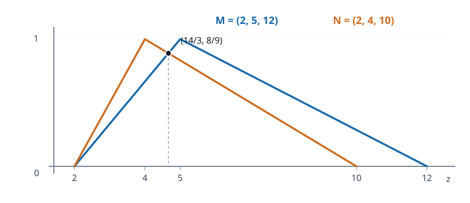

# Handwritten LR example: membership branches and corrections

**Direct source data (page 3 of the 3 Aban scan):**

$$M=(2,5,12),\qquad N=(2,4,10).$$

For a triangle $(a,b,c)$ with $a<b<c$, the unique continuous, piecewise-linear **normalized triangular membership function** is

$$\mu(z)=\begin{cases}
0,&z\notin[a,c],\\
(z-a)/(b-a),&a\le z\le b,\\
(c-z)/(c-b),&b\le z\le c.
\end{cases}$$

## 1. The four pieces

The two branches for $M$ are

$$M_L(z)=\frac{z-2}{3},\quad 2\le z\le5,\qquad
M_R(z)=\frac{12-z}{7},\quad5\le z\le12.$$

For $N$, the correct slopes are governed by $4-2=2$ and $10-4=6$:

$$N_L(z)=\frac{z-2}{2},\quad2\le z\le4,\qquad
N_R(z)=\frac{10-z}{6},\quad4\le z\le10.$$

All four functions equal $1$ at their respective modes, and vanish at the support endpoints. Outside the indicated intervals each branch is zero. At an endpoint where two branches meet, there is no ambiguity.

## 2. Explicit correction of the scan

The handwritten $N_L$ appears with denominator $4$ in the rearranged expression $1+(z-4)/4$, and $N_R$ with denominator $-4$ in $1+(z-4)/(-4)$. **These are not consistent** with $(2,4,10)$:

- $1+(2-4)/4=1/2\ne0$, but $N$ must vanish at $z=2$.
- $1+(10-4)/(-4)=-1/2\ne0$, and a membership function cannot be negative.

The consistent replacements are $1+(z-4)/2=(z-2)/2$ on the left and $1+(z-4)/(-6)=(10-z)/6$ on the right. This is a **mathematical correction by the authors**, not an assertion about what the instructor intended to write.

## 3. Geometry before doing integrals

The intervals are $\operatorname{supp}M=[2,12]$, $\operatorname{supp}N=[2,10]$ and the modes are $5$ and $4$. The two curves cross away from the common support start at

$$\frac{z-2}{3}=\frac{10-z}{6}\quad\Longrightarrow\quad\boxed{z=\frac{14}{3}}.$$

This is **$M_L$ intersecting $N_R$**, not $M_R$ intersecting $N_L$: the latter have disjoint active interiors, since $M_R$ starts at $5$ while $N_L$ ends at $4$.

The diagram, exact intersection and the mathematical corrections are independent educational additions. The source provides the original numerical example and the instruction to write all four branches.
