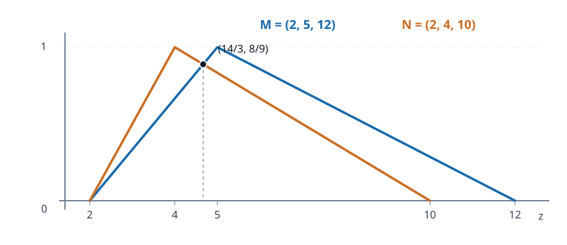

# مثال جدید جزوه: بازسازی تابع عضویت و اصلاح فرمول‌ها

**دادهٔ صریح صفحهٔ سوم جزوهٔ ۳ آبان:**

$$M=(2,5,12),\qquad N=(2,4,10).$$

برای هر مثلث $(a,b,c)$ با شرط $a<b<c$، تابع عضویت مثلثیِ نرمال برابر است با

$$\mu(z)=\begin{cases}
0,&z\notin[a,c],\\
(z-a)/(b-a),&a\le z\le b,\\
(c-z)/(c-b),&b\le z\le c.
\end{cases}$$

## ۱. نوشتن چهار شاخه

برای عدد فازی $M$:

$$M_L(z)=\frac{z-2}{3},\quad 2\le z\le5,\qquad
M_R(z)=\frac{12-z}{7},\quad5\le z\le12.$$

برای عدد فازی $N$، طول بخش چپ $4-2=2$ و طول بخش راست $10-4=6$ است؛ پس

$$N_L(z)=\frac{z-2}{2},\quad2\le z\le4,\qquad
N_R(z)=\frac{10-z}{6},\quad4\le z\le10.$$

هر تابع در رأس عدد مربوط به خودش برابر $1$ و در دو سر تکیه‌گاه برابر $0$ است. بیرون از بازهٔ تعیین‌شده نیز مقدار عضویت صفر است.

## ۲. ناسازگاری در نسخهٔ دست‌نویس

در صفحهٔ سوم برای شاخهٔ چپ $N$ عبارت $1+(z-4)/4$ و برای شاخهٔ راست $N$ عبارت $1+(z-4)/(-4)$ دیده می‌شود. این مخرج‌ها با سه‌تایی $(2,4,10)$ سازگار نیستند:

- در کران چپ، عبارت اول مقدار $1/2$ می‌دهد، درحالی‌که باید صفر شود.
- در کران راست، عبارت دوم مقدار $-1/2$ می‌دهد، درحالی‌که عضویت نباید منفی باشد.

**اصلاح ریاضی:** فرمول چپ باید $1+(z-4)/2=(z-2)/2$ و فرمول راست باید $1+(z-4)/(-6)=(10-z)/6$ باشد. این اصلاح را مستقل از متن جزوه انجام داده‌ایم و آن را به‌عنوان پاسخ قطعیِ نوشته‌شده توسط استاد معرفی نمی‌کنیم.

## ۳. پیدا کردن نقطهٔ تقاطع

تکیه‌گاه‌ها $[2,12]$ و $[2,10]$ و رأس‌ها به‌ترتیب $5$ و $4$ هستند. برخورد دو منحنی در بخش داخلی از تساوی شاخهٔ **چپ $M$** و شاخهٔ **راست $N$** به دست می‌آید:

$$\frac{z-2}{3}=\frac{10-z}{6}\quad\Longrightarrow\quad\boxed{z=\frac{14}{3}}.$$

دقت کنید که شاخهٔ راست $M$ از $5$ شروع می‌شود و شاخهٔ چپ $N$ در $4$ تمام می‌شود؛ بنابراین این دو شاخه در داخل تکیه‌گاه‌هایشان اصلاً یکدیگر را قطع نمی‌کنند.

رسم نمودار، پیدا کردن مقدار دقیق تقاطع و بررسی ناسازگاری‌ها **تکمیل مستقل** مطالب دست‌نویس است.
