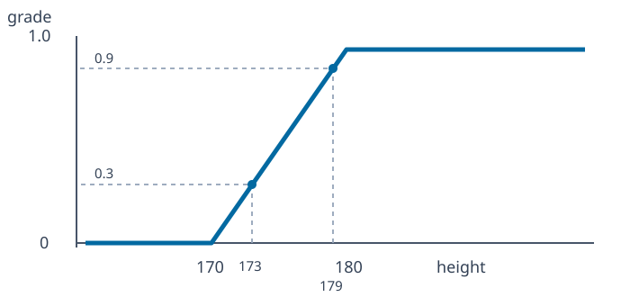

# Height example: three levels of modeling

The scan's five-student example distinguishes a crisp decision, a fixed fuzzy membership rule, and hesitancy between multiple membership rules.

## Recorded heights

| Student | a | b | c | d | e |
|---|---:|---:|---:|---:|---:|
| Height (cm) | 173 | 195 | 181 | 179 | 145 |

### Step 1: a crisp convention

With **strict** threshold \(t=180\) cm, define \(A=\{x:\operatorname{height}(x)>180\}\). Then

$$A=\{b,c\},\quad \mathbf1_A=(0,1,1,0,0).$$

This is a modeling choice, not a physiological fact: heights 179 cm and 180 cm lie on opposite sides of the decision rule, even though they may be similar in practice.

### Step 2: one fuzzy convention

The source sketches a transition from 170 to 180 cm. An explicit continuous interpretation is

$$\mu_{\mathrm{tall}}(h)=\begin{cases}
0,&h\le170,\\
(h-170)/10,&170<h<180,\\
1,&h\ge180.
\end{cases}$$

The resulting membership grades are \(\mu(a)=0.3\), \(\mu(b)=1\), \(\mu(c)=1\), \(\mu(d)=0.9\), and \(\mu(e)=0\). The endpoints and linear interpolation are stated **assumptions** inferred from the diagram.

### Step 3: hesitant membership

Different evaluators might use different ramp intervals (the handwritten page illustrates 140–190 and 150–170 cm). This leads to multiple plausible grades for the **same person**:

$$h_H(x)=\{\mu^{(1)}(x),\mu^{(2)}(x),\ldots\}.$$

Those alternate intervals are examples of how the definition changes with the evaluator; the scan does **not** provide a complete measured HFS for all five students. The numerical degrees for the alternate ramps must be treated as independent illustration, not sourced experimental observations.
