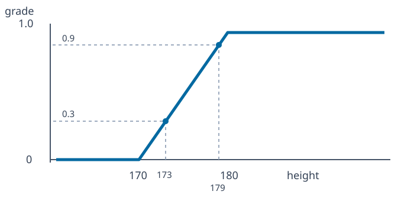

# مثال قد دانشجویان: از مجموعهٔ قطعی تا فازی مردد

در مثال پنج دانشجوی صفحه‌های اول و دوم، می‌توان یک ویژگی مثل «قدبلند بودن» را به سه شیوه مدل کرد: تعریف قطعی، تابع عضویت فازی مشخص و چند تعریف محتمل از تابع عضویت.

## اطلاعات مسئله

| دانشجو | a | b | c | d | e |
|---|---:|---:|---:|---:|---:|
| قد (سانتی‌متر) | 173 | 195 | 181 | 179 | 145 |

### گام ۱: تصمیم قطعی

اگر معیار را **قد بزرگ‌تر از ۱۸۰ سانتی‌متر** قرار دهیم،

$$A=\{x:\operatorname{height}(x)>180\}=\{b,c\}.$$

بنابراین تابع مشخصه برای \(a,b,c,d,e\) به‌ترتیب \((0,1,1,0,0)\) است. این مرز قراردادی است؛ مثلاً فردی با قد ۱۷۹ سانتی‌متر از مجموعه حذف می‌شود، هرچند به ۱۸۰ بسیار نزدیک است.

### گام ۲: تعریف فازی واحد

نمودار جزوه، تغییر تدریجی درجهٔ عضویت از قد ۱۷۰ تا ۱۸۰ را نشان می‌دهد. بیان ریاضی سازگار با نمودار چنین است:

$$\mu_{\mathrm{tall}}(h)=\begin{cases}
0,&h\le170,\\
(h-170)/10,&170<h<180,\\
1,&h\ge180.
\end{cases}$$

در نتیجه برای دانشجویان \(a,b,c,d,e\)، درجات عضویت به‌ترتیب **۰٫۳، ۱، ۱، ۰٫۹ و ۰** است. خطی‌بودن بخش میانی و مقادیر مرزی، فرض صریحِ بازسازی نمودارند.

### گام ۳: مدل‌سازی مردد

اگر افراد مختلف برای «قدبلند بودن» مرزهای متفاوتی انتخاب کنند، برای یک فرد چند مقدار عضویت محتمل به دست می‌آید:

$$h_H(x)=\{\mu^{(1)}(x),\mu^{(2)}(x),\ldots\}.$$

در صفحهٔ دوم، بازه‌های متفاوتی مانند **۱۴۰ تا ۱۹۰** و **۱۵۰ تا ۱۷۰** برای نمایش اختلاف‌نظر رسم شده‌اند. جزوه جدول کامل درجات نهایی این تعریف‌های جایگزین را ارائه نمی‌کند؛ بنابراین نباید اعداد حاصل از فرض‌های جدید را دادهٔ واقعی کلاس معرفی کرد.
